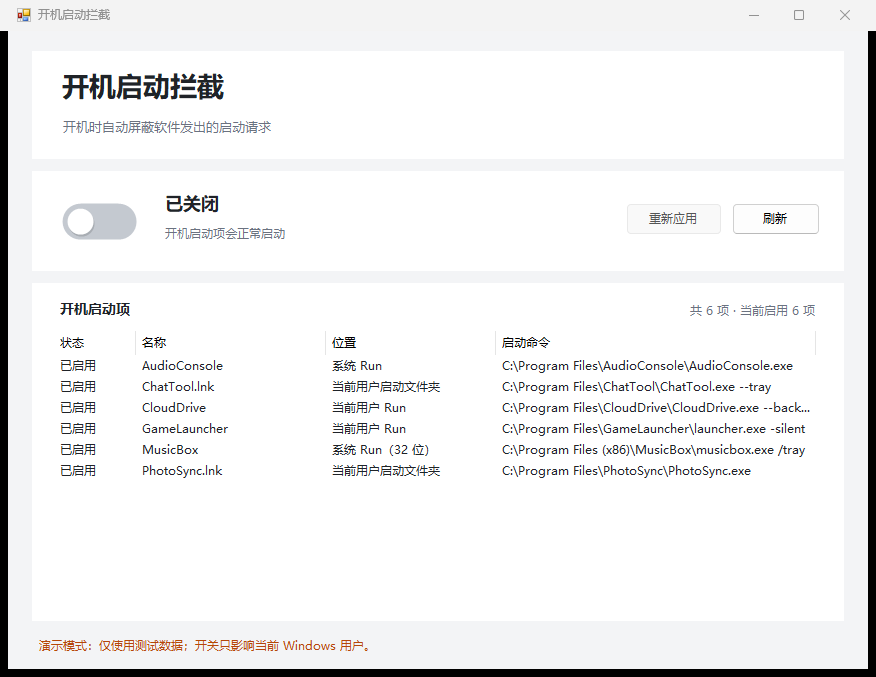
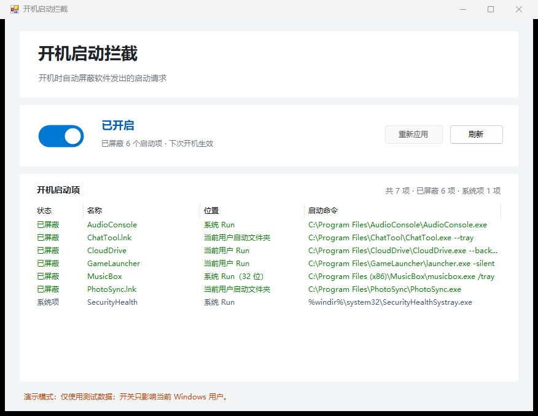

# 开机启动拦截（Startup Guard）

一个开关，用来屏蔽开机时各软件自动发出的启动请求。

开启开关后，当前 Windows 用户下次登录时，所有已启用的第三方开机启动项都会被跳过（Windows 系统项默认保护）；关闭开关后，工具会精确恢复开启前的状态。工具不删除任何注册表启动项或启动文件夹快捷方式，也不需要管理员权限。

**开关只取消「开机自动启动」，不会禁用或删除软件，也不会阻止你手动打开。** 被阻止自启的程序仍可从桌面、开始菜单或安装目录正常启动。





> 截图使用带「演示模式」标记的测试数据，未展示或修改本机真实启动项。列表中 `GameLauncher`
> 和 `MusicBox` 未勾选，因此不会被拦截；`SecurityHealth` 是 Windows 系统项，保持「系统项」
> 状态、不会被拦截。

## 安装到桌面（推荐）

在本目录打开 PowerShell，执行：

```powershell
powershell -NoProfile -ExecutionPolicy Bypass -File .\install.ps1
```

脚本会把程序复制到 `%LOCALAPPDATA%\StartupGuard\app`，生成程序图标，并在桌面创建
「开机启动拦截」快捷方式。双击快捷方式即可打开开关窗口；安装完成后即使删除本仓库，
程序仍可独立运行。

- 重复执行 `install.ps1` 即可用当前文件更新安装；开关状态文件
  `%LOCALAPPDATA%\StartupGuard\state.json` 不会被覆盖。
- 只安装文件、不创建桌面快捷方式：加 `-NoShortcut`。
- 卸载：先在窗口中关闭开关，再删除桌面快捷方式和 `%LOCALAPPDATA%\StartupGuard` 文件夹。

## 在仓库中直接运行

1. 双击 `StartupGuard.cmd` 打开窗口。
2. 点击左上角的开关：蓝色为开启，灰色为关闭。
3. 关闭窗口不会改变开关状态，下次登录仍然生效。

运行环境：Windows 10 / 11 自带的 Windows PowerShell 5.1，无需安装任何依赖，无需管理员权限。

## 开关行为

**开启** 只取消自动启动，不阻止程序运行。它会遍历当前能看到的所有开机启动项，对其中处于启用状态、已勾选、且不属于系统项的项写入当前用户的
`StartupApproved` 禁用标记（这正是任务管理器「禁用」按钮使用的机制），并把原始标记
保存到状态文件：

- 已经是禁用状态的项不会被改动。
- 已屏蔽的项在每次登录时都会继续被跳过；即使软件重新写入同名启动项，标记仍然有效。
- 开关开启后新安装或重新启用的启动项不会被自动拦截，界面会提示「另有 N 项又启用了」，
  点击「重新应用」即可补上。

**关闭** 只恢复本工具记录过的项：原来没有标记的删除标记，原来有标记的写回原始字节。
用户此前手动禁用的项保持禁用。关闭后，这些程序会恢复随登录自动启动。

**重新应用** 在开关开启时可用，用来处理后来新增或重新启用的启动项。

## 逐项选择拦截范围

列表每一行左侧都有勾选框：

- **勾选** = 开关开启时阻止该项开机自启。
- **取消勾选** = 不拦截该项；它仍会正常开机自启，也可以随时手动打开。
- 系统项固定为「系统项」，不会出现可选中的拦截勾选。
- 开关开启时，勾选/取消会立即生效；开关关闭时只保存选择，下次开启开关时应用。
- 选择保存在状态文件的 `excluded` 列表中；命令行 `-Exclude` 与界面共享同一份列表。
- 由命令行通配符排除的项显示为未勾选；如果要在界面里重新勾选，请先在命令行修改对应规则。
- 已由任务管理器等方式禁用的项也可以勾选；等它恢复启用后，点「重新应用」即可按选择拦截。

## 屏蔽范围

| 位置 | 说明 |
| --- | --- |
| `HKCU\...\CurrentVersion\Run` | 当前用户的 Run 启动项 |
| `HKLM\...\CurrentVersion\Run` | 所有用户的 Run 启动项（按当前用户屏蔽） |
| `HKLM\...\WOW6432Node\...\Run` | 32 位程序的 Run 启动项 |
| 用户启动文件夹 | `%APPDATA%\Microsoft\Windows\Start Menu\Programs\Startup` 中的 `.lnk` |
| 公共启动文件夹 | `%ProgramData%\Microsoft\Windows\Start Menu\Programs\StartUp` 中的 `.lnk` |

**不处理**：Windows 服务、计划任务、`RunOnce`、MSIX/商店应用的启动任务、组策略启动
脚本、驱动。它们使用不同的机制，其中部分需要管理员权限；本工具刻意保持「每用户、
可逆、免管理员」的定位。

## 系统项保护

以下启动项始终显示为「系统项」，开关开启时也不会被屏蔽：

- 名称以 `SecurityHealth`、`Windows Security`、`Windows Defender` 开头的项（Windows 安全中心）。
- 可执行文件位于 `%SystemRoot%`（通常是 `C:\Windows`）下的系统组件，例如
  `%windir%\system32\SecurityHealthSystray.exe`。
- `%ProgramFiles%\Windows Defender\` 下的组件。

由 `wscript.exe` / `cscript.exe` / `cmd.exe` / `powershell.exe` 启动的用户脚本不算系统项，
仍会按普通启动项处理；可以通过 `-Exclude` 排除。

Realtek 音频面板、反作弊托盘等第三方程序不在系统保护范围内；如果希望保留，请把它们
加入排除列表。当前机器上被保护的是 `SecurityHealth`（Windows 安全中心托盘），它只是
托盘程序，不是 Windows 服务或驱动。

## 安全提醒

开关默认拦截列表中**已勾选**的所有启用项（Windows 系统项除外），包括第三方安全软件托盘、
游戏反作弊托盘，以及像「大肥鱼开关」这类电源监控脚本。Windows 安全中心托盘默认受保护。
如果某个启动项必须保留，取消勾选或把它加入排除列表：

```powershell
# 在 PowerShell 中进入本目录
.\startup-guard.ps1 on -Exclude "大肥鱼开关*"
```

- 排除项会保存在状态文件中，与界面的勾选状态共享；后续打开开关时也会遵守。
- 如果开关已经开启，再执行上面的命令会立即释放被排除的项。
- 清空排除列表：`.\startup-guard.ps1 on -Exclude ""`（会重新屏蔽这些项）。
- 支持通配符 `*` 和 `?`；匹配的是启动项名称（Run 值名或 `.lnk` 文件名）。

## 命令行

```powershell
.\startup-guard.cmd status          # 开关状态 + 启动项列表
.\startup-guard.cmd list            # 只看启动项列表
.\startup-guard.cmd on              # 开启开关
.\startup-guard.cmd off             # 关闭开关并恢复
.\startup-guard.cmd on -DryRun      # 只显示将要做什么，不修改
.\startup-guard.cmd status -Json    # 机器可读输出
```

`status` 中每一项的状态含义：

| 状态 | 含义 |
| --- | --- |
| `Blocked` | 本工具已阻止其开机自启；程序仍可手动打开，关闭开关会恢复自动启动 |
| `Enabled` | 当前会随登录启动 |
| `Disabled` | 已被其他方式（任务管理器等）禁用，工具不会改动 |
| `Excluded` | 未勾选或命中排除列表；开关开启时不会拦截 |
| `Protected` | Windows 系统组件，工具默认不屏蔽 |
| `Unknown` | `StartupApproved` 标记无法识别，工具跳过并给出警告 |

## 状态文件与恢复

状态文件位于：

```
%LOCALAPPDATA%\StartupGuard\state.json
```

它保存开关状态、排除列表，以及每个被屏蔽项开启前的原始 `StartupApproved` 字节。
**请不要在开关开启时删除它**，否则工具将不知道如何恢复原来的配置。

- 正常卸载：先执行 `off`，再删除 `startup-guard` 文件夹和 `%LOCALAPPDATA%\StartupGuard`。
- 如果状态文件丢失：被屏蔽的项会显示为 `Disabled`，可以在任务管理器的「启动应用」
  中手动重新启用；工具无法自动推断原来的状态。
- 状态文件损坏时，命令会给出明确错误而不是猜测处理；修复或删除前请先确认启动项现状。

## 工作原理

Windows 资源管理器在登录时除了读取 Run 键和启动文件夹，还会读取当前用户的
`StartupApproved` 覆盖层：

```
HKCU\Software\Microsoft\Windows\CurrentVersion\Explorer\StartupApproved\
    Run             ← HKCU Run + HKLM Run（64 位）
    Run32           ← HKLM WOW6432Node Run（32 位）
    StartupFolder   ← 用户和公共启动文件夹
```

每个值是与启动项同名的 12 字节二进制数据：首字节 `0x03` 表示禁用，`0x02` 表示启用，
后 8 字节是时间戳。写入这个覆盖层只影响当前用户，不修改 `HKLM` 本身，也不需要管理员
权限。本工具只写覆盖层，不删除 `Run` 值或 `.lnk` 文件。

## 开发与测试

```powershell
powershell -NoProfile -ExecutionPolicy Bypass -File tests\StartupGuard.Tests.ps1
```

测试完全在沙箱中进行：注册表使用临时键
`HKCU\Software\StartupGuardTests\<guid>`，启动文件夹使用临时目录，不会触碰真实的
启动配置；测试结束前还会对比真实 `StartupApproved` 键的快照，确认它们没有被改动。
共 21 个用例，覆盖列表、屏蔽、精确恢复、启动文件夹、漂移重应用、排除、逐项选择
（开关关闭时保存、开关开启时立即应用）、试运行、空操作、未知标记、同名覆盖层、
卸载后的残留标记、系统项保护与旧记录释放、旧状态空排除清理、损坏状态文件和桌面安装。

界面截图由 GUI 的测试参数生成（仅在指定 `-SandboxRoot` 时可用）：

```powershell
.\StartupGuard.Gui.ps1 -SandboxRoot "Software\StartupGuardDemo" -CapturePrefix "C:\Temp\startup-guard"
```

## 目录结构

```
startup-guard/
├─ StartupGuard.cmd          # 双击启动图形界面
├─ StartupGuard.Gui.ps1      # 图形界面
├─ StartupGuard.psm1         # 核心逻辑（枚举、开关、状态文件）
├─ install.ps1               # 安装到本机并创建桌面快捷方式
├─ startup-guard.cmd         # 命令行入口
├─ startup-guard.ps1         # 命令行实现
├─ docs/                     # 开关关闭 / 开启截图
└─ tests/                    # 沙箱集成测试
```

## 已知限制

- 只覆盖任务管理器「启动应用」能看到的机制，不覆盖服务、计划任务、`RunOnce`、
  商店应用启动任务和组策略脚本。
- 按用户生效：`HKLM` 启动项只对当前用户屏蔽，其他 Windows 用户不受影响。
- 没有常驻进程：开关开启后新出现的启动项需要点「重新应用」。
- 已在 Windows 11 + Windows PowerShell 5.1 上验证枚举、开关、恢复与界面；沙箱测试
  不涉及真实登录流程。`StartupApproved` 是 Windows 任务管理器使用的公开机制。
