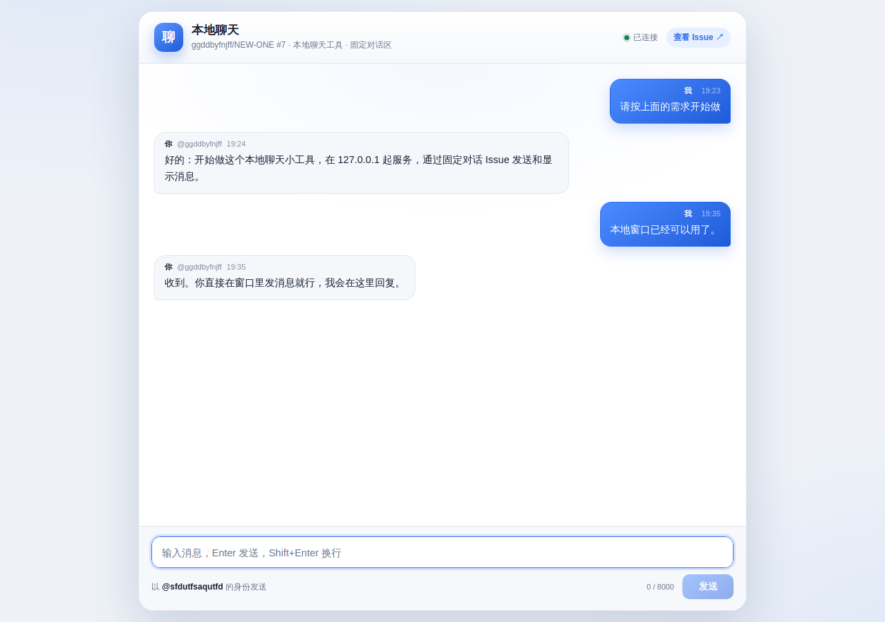

# 本地聊天小工具（GitHub Issue 版）

不用打开 GitHub 网页，在本地聊天窗口里和 `@ggddbyfnjff` 对话：你发出的消息会以评论形式写到固定对话 Issue，对方在 Issue 里的新回复会自动显示在窗口中。

固定对话 Issue：[ggddbyfnjff/NEW-ONE#7](https://github.com/ggddbyfnjff/NEW-ONE/issues/7)

界面预览（演示数据）：



- Node.js 18+，无第三方依赖
- 服务只监听 `127.0.0.1`
- GitHub 令牌只在本地 Node 进程中读取，不会发送给浏览器，也不会写进日志
- 浏览器界面每 4 秒轮询一次本地服务，由本地服务调用 GitHub API

## 快速开始（Windows）

1. 安装 [Node.js](https://nodejs.org/) 18 或更高版本。
2. 在 GitHub 创建访问令牌（建议用 Fine-grained token）：
   - 打开 <https://github.com/settings/tokens?type=beta>
   - Repository access 只选 `ggddbyfnjff/NEW-ONE`
   - Permissions 中把 **Issues** 设为 **Read and write**
   - **Metadata** 保持 **Read-only**（GitHub 要求）
   - 令牌必须属于账号 `sfdutfsaqutfd`，消息会以该账号身份发出
   - 如果 Fine-grained token 页面无法选择这个公开仓库，可以改用 classic token，并勾选 `public_repo` 权限
3. 把令牌保存到本目录的 `token.txt`：
   - 文件里只放一行令牌，不要加引号
   - 也可以改用环境变量 `GITHUB_TOKEN`（见下面的配置表）；环境变量优先
4. 双击 `start-chat.cmd`。
5. 浏览器会自动打开 <http://127.0.0.1:3210/>；如果没有自动打开，手动访问这个地址。
6. 在输入框输入消息，按 Enter 发送，Shift+Enter 换行。

`token.txt` 已加入 `.gitignore`，不会被提交。任何情况下都不要把令牌写进源码、Issue 或截图。

## 配置

所有配置都可以用环境变量覆盖；Windows 下可以临时 `set` 后启动，或写在自己的启动脚本里。

| 环境变量 | 默认值 | 说明 |
| --- | --- | --- |
| `GITHUB_TOKEN` | 空 | 访问令牌；优先于令牌文件 |
| `CHAT_GITHUB_TOKEN` | 空 | `GITHUB_TOKEN` 的备用变量名 |
| `CHAT_TOKEN_FILE` | 本目录 `token.txt` | 令牌文件路径 |
| `CHAT_REPO` | `ggddbyfnjff/NEW-ONE` | 仓库 |
| `CHAT_ISSUE` | `7` | 固定对话 Issue 编号 |
| `CHAT_PORT` | `3210` | 本地端口 |
| `CHAT_POLL_MS` | `4000` | 页面轮询间隔（毫秒） |
| `CHAT_MENTION` | `@ggddbyfnjff` | 每条消息开头 @ 的账号 |
| `CHAT_GITHUB_API` | `https://api.github.com` | 仅开发/测试使用 |

想换一个对话 Issue，例如新建一个专用 Issue：

```bat
set CHAT_ISSUE=12
start-chat.cmd
```

## 工作方式

1. 页面通过 `POST /api/messages` 把文字发给本地 Node 服务。
2. 本地服务用令牌调用 GitHub API，在 `CHAT_REPO` 的 `CHAT_ISSUE` 中发评论：`@ggddbyfnjff ` + 你输入的文字。
3. 页面定时轮询 `GET /api/messages`，本地服务从 GitHub 拉取 Issue 的最新评论。
4. 界面按评论作者区分：令牌所属账号的评论显示为「我」在右侧，其他人的评论显示为「你」在左侧。自己的消息会自动去掉开头的 `@ggddbyfnjff`，看起来更像普通聊天。

第一次打开会加载最近一至两页评论（最多约 200 条），之后每次轮询只取有更新的评论。服务重启后会重新从最近的历史开始加载。

## 安全、隐私与限制

- **这个仓库是公开的**，Issue 评论也会公开可见。不要把密码、令牌、私密内容发进聊天窗口。
- 本地服务没有额外的登录口令，只监听 `127.0.0.1`，并校验 `Host`、`Origin` 和 JSON Content-Type，避免被其他网站利用；同一台电脑上的其他程序仍然可以访问本机端口。
- `token.txt` 是本机明文文件，请设置合适的文件权限，不要同步到网盘或提交到仓库。
- 消息只支持纯文本，不支持附件和图片；窗口里不能编辑或撤回已经发出的评论。
- 在 GitHub 上删除的评论不会立即从本地缓存消失；重启工具后会重新加载。
- 回复不是实时的，默认每 4 秒刷新；GitHub API 偶尔变慢或限流时会自动退避重试。

## 常见问题

**启动时提示未找到访问令牌**
把令牌写入 `tools/chat/token.txt`，或先设置 `GITHUB_TOKEN` 再启动。文件里只能有一行令牌。

**启动时提示令牌无效 / 权限不足（401、403）**
确认令牌属于 `sfdutfsaqutfd`，且对该仓库有 Issues 读写权限；Fine-grained token 还需要 Metadata 只读权限。

**找不到仓库或 Issue（404）**
确认 `CHAT_REPO` / `CHAT_ISSUE` 正确，Issue 没有被删除。默认是 `ggddbyfnjff/NEW-ONE#7`。

**端口被占用**
设置 `CHAT_PORT=3211` 后重新启动。

**打不开页面 / 一直显示刷新失败**
确认启动窗口还在运行、没有报错；手动打开窗口里打印的地址。关闭启动窗口或按 Ctrl+C 会停止服务。

## 开发与测试

```bat
cd tools/chat
npm test
```

测试使用本地模拟 GitHub API，不需要令牌，也不会访问网络。开发时可以：

```bat
set GITHUB_TOKEN=你的令牌
node server.js
```

文件结构：

```
tools/chat/
  server.js              启动入口（连接 GitHub、监听 127.0.0.1）
  start-chat.cmd         Windows 双击启动
  src/config.js          环境变量与令牌读取
  src/github.js          GitHub REST 客户端、评论归一化
  src/sync.js            本地评论缓存与轮询合并
  src/server.js          静态页面与 /api/messages 接口
  public/                聊天界面（HTML/CSS/JS，无构建步骤）
  test/                  Node 内置测试
  test-support/          离线模拟 GitHub API（仅测试用）
  docs/                  界面截图
```
